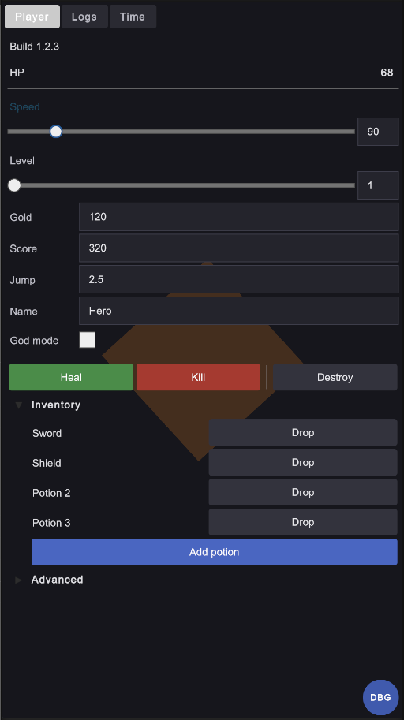
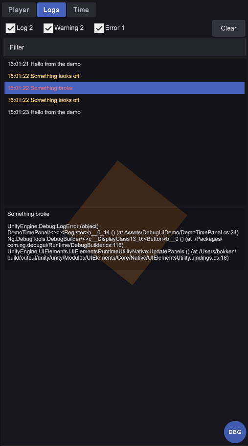

# Ng Debug UI

In-game debug UI for Unity, built on UI Toolkit. Declare panels in code with lambdas, then tweak and
watch values while the game runs — on desktop (mouse) and mobile (touch). No prefabs, no scene setup.
Stripped from release builds automatically.

<table>
  <tr>
    <td align="center"></td>
    <td align="center"></td>
  </tr>
  <tr>
    <td align="center">Panels built from code</td>
    <td align="center">Built-in log panel</td>
  </tr>
</table>

## Install

Requires Unity 6000.0 or newer.

*Window → Package Manager → **+** → Install package from git URL…* and paste:

```
https://github.com/nguyen991/unity-debugui.git?path=/Packages/com.ng.debugui
```

Add `#v0.1.0` (or any tag / commit) at the end to pin a version. More options — `manifest.json`,
updating, local copy — in [Install](Packages/com.ng.debugui/README.md#install).

## Quick look

```csharp
using Ng.DebugTools;
using UnityEngine;

public class Player : MonoBehaviour
{
    public int hp = 100, maxHp = 100, gold;
    public float speed = 5;

    void OnEnable()
    {
        // `this` owns the panel: it disappears when this object is destroyed.
        DebugUI.Panel(this, "Player", p => p
            .Label("HP", () => hp)
            .Slider("Speed", () => speed, v => speed = v, 0, 20)
            .Field("Gold", () => gold, v => gold = v)
            .Horizontal(h => h
                .Button("Heal", () => hp = maxHp, Color.green)
                .Button("Kill", () => hp = 0, Color.red)));
    }
}
```

Tap the round **DBG** button (bottom-right) to open it, or press **`** (backquote) when the Input System
package is installed.

- Labels, buttons, sliders, input fields, toggle buttons (pick one or several), foldouts, horizontal/vertical layouts, lists that change at runtime
- Built-in log panel with filters, search and stack traces
- Getters are only polled while the UI is open, and only for the visible panel
- Themable with your own USS; `DebugUI.Scale` for bigger touch targets

## Documentation

The full guide is the [package README](Packages/com.ng.debugui/README.md):

- [Install](Packages/com.ng.debugui/README.md#install) — Git URL, `manifest.json`, pinning and updating
- [Usage](Packages/com.ng.debugui/README.md#usage) — panels, owners, removing panels
- [Controls](Packages/com.ng.debugui/README.md#controls) — every builder method
- [Lists that change at runtime](Packages/com.ng.debugui/README.md#lists-that-change-at-runtime-each) — `Each`
- [Toggle buttons](Packages/com.ng.debugui/README.md#toggle-buttons-toggles) — `Toggles`: enum, `[Flags]`, index or bools
- [Built-in log panel](Packages/com.ng.debugui/README.md#built-in-log-panel)
- [How values stay in sync](Packages/com.ng.debugui/README.md#how-values-stay-in-sync)
- [Opening the UI](Packages/com.ng.debugui/README.md#opening-the-ui) — DBG button, shortcut, window size
- [Behavior details](Packages/com.ng.debugui/README.md#behavior-details)
- [Styling](Packages/com.ng.debugui/README.md#styling) — `Scale`, custom USS, class reference
- [Builds](Packages/com.ng.debugui/README.md#builds) — what is stripped from release builds
- [Known limitations](Packages/com.ng.debugui/README.md#known-limitations)

## Sample

*Package Manager → Ng Debug UI → Samples → Demo → Import* adds a scene that uses every control.

## Repository layout

| Path | Contents |
|---|---|
| [`Packages/com.ng.debugui`](Packages/com.ng.debugui) | the package (runtime, tests, sample) |
| `Assets/DebugUIDemo` | working copy of the demo scene used while developing |
| `docs/img` | screenshots for this README |
